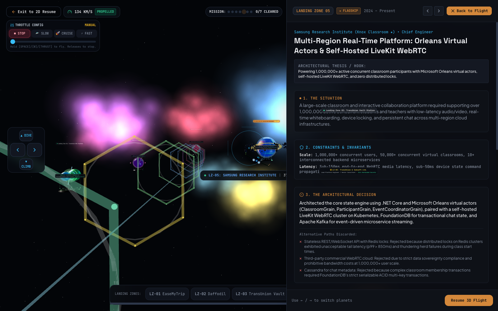

# Sourabh Rustagi — Chief Systems & Cloud-Native Architect

> **Agentic AI & Platform Engineering**  
> 📍 New Delhi, India | 📞 +91-84708-94772 | ✉️ [sourabh.rustagi@hotmail.com](mailto:sourabh.rustagi@hotmail.com)  
> 🔗 [LinkedIn](https://www.linkedin.com/in/sourabhrustagi) | 🐙 [GitHub](https://github.com/iamsourabh-in) | 🌐 [Live Deployment](https://iamsourabh-in.github.io/folio-v3/)  

---

## 3D Cosmic Flight Simulator & Systems Architecture Portfolio



A dual-mode systems engineering portfolio engineered with zero bloat:
1. **Spaceship Cosmic Flight Simulator (3D Mode):** Pilot an aerospace scout ship through an authored 7-sector galactic corridor with vibrant multi-colored cosmic nebulae, procedural PBR planet surfaces, Rayleigh atmospheric scattering, and **dedicated physical 3D Landing Zone Pads for each company**. Touch down on each company's landing zone to trigger verified architectural proofs and mission achievements.
2. **Executive Skim Mode (2D Mode):** A clean, high-contrast editorial architecture dossier readable in under 60 seconds with 100% technical substance, zero fluff, and an initial bundle under **87 kB gzip**.

---

## Company Landing Zones & Architectural Proofs

| Landing Zone | Company & Tenure | Core Challenge & Architecture | Measurable Outcome |
| :--- | :--- | :--- | :--- |
| **LZ-01** | **Inventra Technologies & EaseMyTrip** (2013–2016) | B2B Travel Search Aggregator & Database Throughput | 100k+ monthly transactions, 40-50% DB latency reduction |
| **LZ-02** | **Daffodil Software Ltd.** (2016–2021) | Serverless Healthcare & HIPAA FHIR Interoperability | 99.99% SLA, 10k req/s, Innovation Award (AI Chatbot) |
| **LZ-03** | **TransUnion & Saksoft Ltd.** (2021–2024) | HashiCorp Vault Dynamic Secret Governance | 100% credential rotation, zero hardcoded secrets |
| **LZ-04** | **TransUnion & Saksoft Ltd.** (2021–2024) | Financial AWS EKS, Istio Mesh & Flux v2 GitOps | 90% deployment rollback cut, Terraform IaC adopted by 10+ teams |
| **LZ-05 ★** | **Samsung Research Institute** (2024–Present) | Distributed Virtual Actors & LiveKit WebRTC Core | **1,000,000+ active concurrent users**, <45ms WebRTC, 0 locks |
| **LZ-06** | **Samsung Research Institute** (2024–Present) | Agentic AI, Memory-as-a-Service & MCP | Knowledge Graph + Temporal memory, Ollama, OpenClaw & Hermes |
| **LZ-07** | **Open Source & Global Leadership** (2013–Present) | Zero-Bloat Open Source & Maintainer Culture | 28,500+ downloads (`ngx-txt-img`), 13+ years continuous leadership |

---

## 3D Spaceship Flight Mechanics & Company Landing Zones

- **Physical 3D Company Landing Zones:** Every company in Sourabh's career features an illuminated octagonal docking platform with vertical guidance laser pylons, animated rotating holographic reticles, and real-time touchdown confirmation telemetry.
- **Vibrant Cosmic Worlds:** Dynamic volumetric nebula clouds (violet/magenta, electric cyan/turquoise, warm solar amber, royal cobalt), 7,000 saturated color-temperature stars, and sector-tinted hexagonal space gates.
- **Authored Narrative Flow:** 7 sequential sectors connected by hexagonal guidance gates. Approaching each landing zone unlocks company achievements, and the Grand Finale modal reveals the verified 13+ year architectural impact matrix.
- **Desktop & Mobile Controls:**
  - `ArrowUp` / `W`: Pitch Down
  - `ArrowDown` / `S`: Pitch Up
  - `ArrowLeft` / `A` or `[◄]`: Bank & steer Left
  - `ArrowRight` / `D` or `[►]`: Bank & steer Right
  - `Shift` / `Space` / `[⚡ BOOST]`: Fire warp afterburners (increases speed, flares thruster plasma, expands camera FOV).
  - `Touch Drag`: Steer spaceship pitch and yaw through 3D space with natural inverted flight pitch.
  - `F` / Reticle Click: Toggle Company Codex scanner.
- **Quantum Autopilot:** Bottom HUD scrubber with clear completion checkmarks (`✓`) and 1-click warp navigation to any company landing zone.
- **Native Web Audio:** Zero-dependency procedural Web Audio API synthesizer for warp whooshes, radar target locks, and achievement fanfare.
- **Instant Skim Exit:** 1-click button to exit 3D flight and return to the 2D technical dossier at any time.

---

## Technology Stack

- **Frontend Core:** React 18, TypeScript, Tailwind CSS, Vite
- **3D Graphics & Shaders:** Three.js, React Three Fiber (`@react-three/fiber`), React Three Drei (`@react-three/drei`)
- **Audio Synthesizer:** Native Web Audio API (zero external runtime dependencies)
- **Icons & Telemetry:** Lucide React
- **CI/CD & Hosting:** GitHub Actions (`actions/deploy-pages@v4`) deploying to GitHub Pages

---

## Getting Started Locally

### Prerequisites
- Node.js 18+
- npm 9+

### Installation
```bash
# Clone the repository
git clone https://github.com/iamsourabh-in/folio-v3.git
cd folio-v3

# Install dependencies
npm ci

# Start local development server
npm run dev
```

### Production Build & Preview
```bash
# Compile TypeScript and bundle with Vite
npm run build

# Preview production build locally on http://localhost:4173/
npm run preview
```

---

## License

MIT License © 2026 [Sourabh Rustagi](https://github.com/iamsourabh-in).
